

# 🛡️ NETWORKWALKS-MALEKAROUA-B084-WK2-PM-FOOTPRINTING-SCANNING

**Building practical reconnaissance, OSINT, and local network discovery capabilities using Kali Linux and Zenmap**

---

## 📌 Project Overview

This project documents hands-on practical exercises covering the reconnaissance and scanning phases of a security assessment. It bridges external open-source intelligence (OSINT) gathering against a target domain (`networkwalks.com`) using Kali Linux tools with internal local subnet discovery (`10.184.114.0/24`) using Zenmap.

---

## 🎯 Objectives

The main goals of these practical labs are:
- Perform passive and active reconnaissance to profile a target domain.
- Master command-line utilities for DNS enumeration, web technology fingerprinting, and WAF detection.
- Execute local network discovery sweeps to identify live hosts, MAC addresses, and active hardware.
- Understand both attacker methodologies (reconnaissance & lateral movement) and SOC defensive perspectives (asset visibility & threat detection).

---

## 🛡️ Scope & Authorization

> ⚠️ **Disclaimer:** All security testing activities were conducted strictly within authorized parameters. Footprinting was performed against `networkwalks.com` under explicit written permission, and network scanning was restricted strictly to the author's local area network (`10.184.114.0/24`).

---

## ⚙️ Environment & Tooling Summary

| Component | Specification / Setting |
| :--- | :--- |
| **Primary OS** | Kali Linux (Reconnaissance) & Windows 10/11 (Scanning) |
| **Target Domain** | `networkwalks.com` |
| **Local Subnet** | `10.184.114.0/24` |
| **Reconnaissance Tools** | `whois`, `whatweb`, `nslookup`, `curl`, `wafw00f`, `dnsrecon` |
| **Scanning Tool** | Zenmap / Nmap (`-sn` Ping Scan) |

---

## 📂 Project Structure & Modules

- **Phase 1: Footprinting & Reconnaissance (W2-PM1)**
  * `whois`: Extracted domain registration details and name servers.
  * `whatweb`: Fingerprinted web server software, WordPress version, and plugins.
  * `nslookup`: Resolved domain names to IP addresses.
  * `curl -I`: Inspected HTTP response headers and API endpoints.
  * `wafw00f`: Identified Web Application Firewall protections (ModSecurity).
  * `dnsrecon`: Enumerated complete DNS record infrastructure (NS, MX, SPF, TXT, SRV).

- **Phase 2: Network Discovery & Scanning (W2-PM5)**
  * Windows `ipconfig` identification of local network layout.
  * Zenmap Ping Scan (`-sn`) across subnet `10.184.114.0/24`.
  * Identification of active live hosts (`10.184.114.38` Gateway, `10.184.114.14` Local Host).
  * Generation and export of the local network topology graph in PDF format.

---

## 📊 Summary of Findings

| # | Finding / Observation | Target / Evidence | Potential Security Impact | Risk Level |
| :-: | :--- | :--- | :--- | :---: |
| **1** | Web technology version exposure | WordPress & WP Download Manager | Assists attackers in mapping software dependency vulnerabilities | **Medium** |
| **2** | Server IP address resolution | `192.232.216.135` | Pinpoints server hosting infrastructure location | **Low** |
| **3** | HTTP Header disclosure | `/wp-json/` REST API endpoint exposed | Aids application mapping and enumeration | **Low** |
| **4** | WAF Identification | ModSecurity (SpiderLabs) detected | Reveals defensive perimeter architecture | **Low** |
| **5** | DNS Infrastructure Exposure | NS, MX, SPF, and TXT records enumerated via `dnsrecon` | Helps build a broader profile of domain services and email servers | **Medium** |
| **6** | Active Local Host Discovery | `10.184.114.14` & `10.184.114.38` | Exposes active devices on the local segment for potential lateral movement | **Medium** |

---

## 🖼️ Evidences Collected

### 1. WHOIS Reconnaissance (`whois networkwalks.com`)
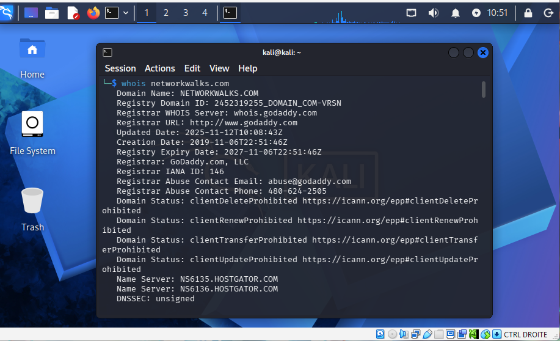
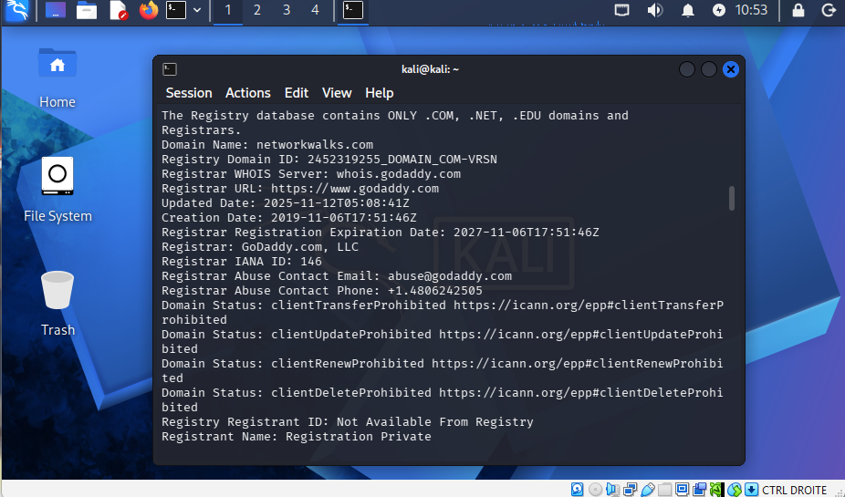

### 2. Web Fingerprinting (`whatweb networkwalks.com`)
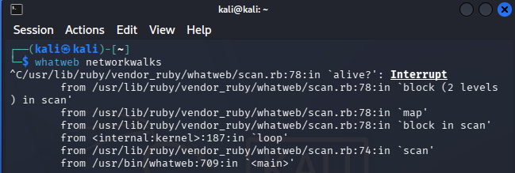
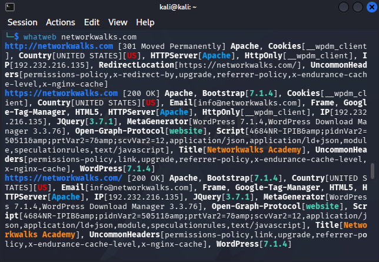

### 3. DNS Resolution (`nslookup networkwalks.com`)
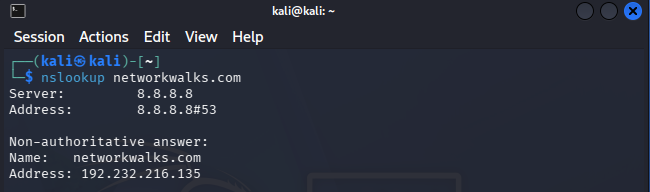

### 4. HTTP Header Inspection (`curl -I https://networkwalks.com`)
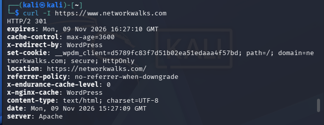

### 5. WAF Detection (`wafw00f networkwalks.com`)
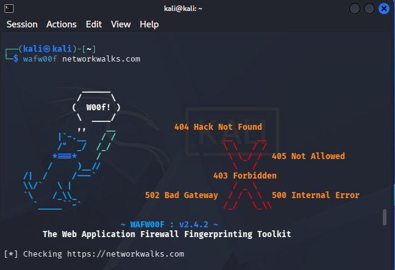
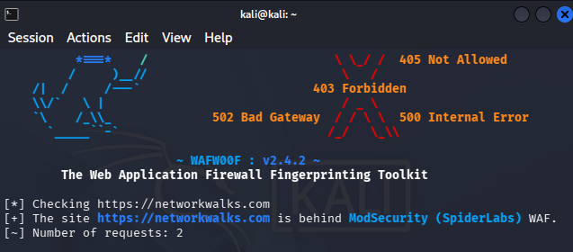

### 6. DNS Record Enumeration (`dnsrecon -d networkwalks.com`)
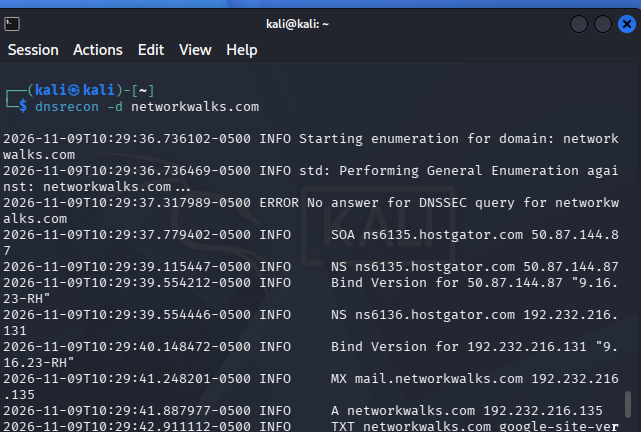
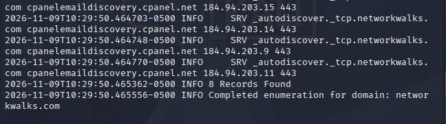

### 7. Upload nmap (`nmap upload`)
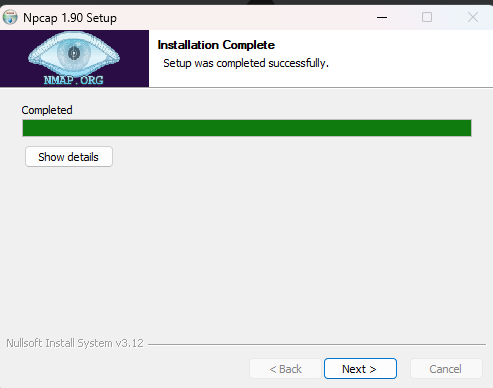
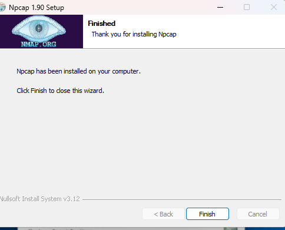

### 8. Zenmap Ping Scan Results (`nmap -sn 10.184.114.0/24`)
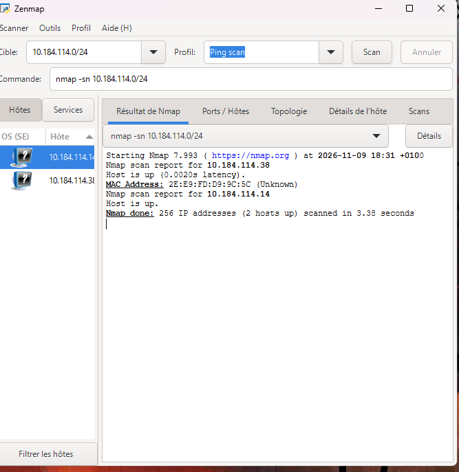

### 9. Zenmap Network Topology Map
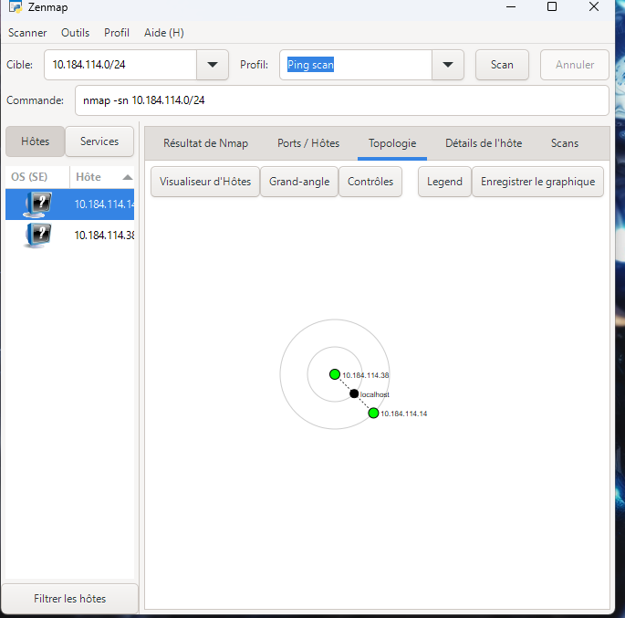

---

## 💡 What I Learned

1. **Information Gathering Value:** Publicly available records and headers often reveal more system details than intended, forming the baseline for vulnerability assessments.
2. **Attacker vs. Defender Mindset:** Attackers use ping sweeps and footprinting to map targets and locate entry points; SOC analysts use the exact same methods to maintain asset inventories and detect unauthorized "Shadow IT" devices.
3. **Structured Documentation:** Compiling findings into professional reports reinforces the importance of clear evidence management and risk communication.

---

## 🔗 Resources & References

- **NetworkWalks Cybersecurity Curriculum**
- **Nmap / Zenmap Official Documentation:** [https://nmap.org](https://nmap.org)

---

## 👤 Author

**Malek Aroua**  
*Computer Networks Graduate | Cybersecurity Specialist*  

---
